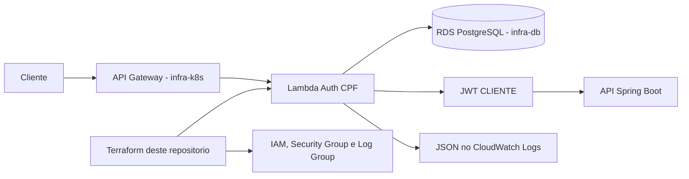

# oficina-dgcar-auth-lambda

Lambda de autenticação externa de clientes da Oficina DGCar. Recebe CPF e senha em `POST /auth/cpf`, consulta PostgreSQL, valida o hash bcrypt e emite JWT com `tipo=CLIENTE`. A API principal valida esse JWT para permitir consultas às OS do próprio cliente. O repositório contém código Node.js, testes, empacotamento e Terraform da função para homolog e prod.

## Tecnologias e arquitetura

Node.js 20, CommonJS, `pg`, `bcryptjs`, `jsonwebtoken`, Jest, Terraform, AWS Lambda, IAM, VPC, CloudWatch Logs e GitHub Actions.



A rota do Gateway é provisionada por infra-k8s. O schema e as migrations pertencem à API; o RDS é provisionado por infra-db.

## Contrato e clientes

`POST /auth/cpf` recebe JSON com `cpf` e `senha`. Em sucesso, responde 200 com `tokenType`, `accessToken` e `expiresIn`. Validação de entrada, credenciais, situação do cliente e falhas internas produzem os códigos definidos no [handler](src/handler.js). O header `X-Correlation-Id` é devolvido nas respostas produzidas pelo handler.

- [Contrato executável da autenticação](src/handler.js) e [formatação das respostas](src/http.js).
- [Collection Postman das APIs](https://github.com/techdgconsulting/oficina-dgcar-api/blob/homolog/postman/Oficina-DGCar-Tech-Challenge-Fase-3.postman_collection.json), pasta de autenticação pelo Gateway.
- [Swagger da API consumidora em execução local](http://localhost:8080/swagger-ui.html) e [OpenAPI JSON](http://localhost:8080/api-docs).
- Em homolog e prod: `${OFICINA_PUBLIC_BASE_URL}/swagger-ui.html` e `${OFICINA_PUBLIC_BASE_URL}/api-docs`.

A Lambda não publica Swagger próprio. O OpenAPI Spring Boot descreve a API principal; o contrato da rota `/auth/cpf` é o handler e sua representação na collection. Não confunda o login de cliente com `/api/auth/login`, destinado a funcionários.

## Instalação, testes e pacote

Com Node.js 20 e npm instalados, na raiz:

```sh
npm ci
npm run lint
npm test
npm run package
```

O pacote é gerado em `dist/auth-cpf-lambda.zip`. Os testes automatizados não exigem uma Lambda publicada; a invocação funcional local exige banco e configuração válidos.

## Invocação local

1. Disponibilize PostgreSQL com as migrations da API, incluindo `clientes.senha_hash` e, para usar status persistido, `clientes.status_cliente`.
2. Configure um cliente de teste com CPF válido, hash bcrypt e status permitido, sem usar dados reais.
3. Copie `.env.example` para `.env` e ajuste as variáveis abaixo. Com o PostgreSQL do Compose da API, a porta no host é **5434**, não 5432.
4. Use Node.js 20.6 ou superior para carregar o arquivo com `--env-file`. Não há servidor HTTP local ou script `npm start` nesse repositório.

| Variável | Configuração |
|---|---|
| `DB_HOST`, `DB_PORT`, `DB_NAME`, `DB_USERNAME`, `DB_PASSWORD` | Banco acessível a partir do processo; porta padrão 5432 |
| `DB_SSL` | `false` para banco local sem TLS; `true` para a conexão RDS configurada pelo workflow |
| `CLIENT_TABLE`, `CLIENT_ID_COLUMN`, `CLIENT_DOCUMENT_COLUMN` | Padrões `clientes`, `id`, `documento` |
| `CLIENT_PASSWORD_HASH_COLUMN` | Padrão do código `senha_hash` |
| `CLIENT_STATUS_COLUMN` | Coluna de status a consultar; veja a distinção abaixo |
| `CLIENT_DEFAULT_STATUS`, `CLIENT_ALLOWED_STATUSES` | Padrões `ATIVO`; permitidos separados por vírgula |
| `CLIENT_JWT_SECRET` | Segredo HS256 adequado, igual ao usado pela API no mesmo ambiente |
| `CLIENT_JWT_ISSUER`, `CLIENT_JWT_AUDIENCE`, `CLIENT_JWT_EXPIRES_IN` | Padrões `oficina-dgcar-auth-lambda`, `oficina-dgcar-api`, `15m` |

A migration V18 da API cria `clientes.status_cliente`. Para consultar essa coluna, configure `CLIENT_STATUS_COLUMN=status_cliente`. O código, o exemplo `.env`, o padrão Terraform e o fallback do workflow deixam essa opção vazia quando não informada. Nesse caso, a consulta utiliza `CLIENT_DEFAULT_STATUS`, sem ler o status persistido. A existência da coluna não altera automaticamente a configuração da Lambda.

Para simular o evento sem imprimir o token retornado, configure `TEST_CLIENT_CPF` e `TEST_CLIENT_PASSWORD` no ambiente local e execute:

```sh
node --env-file=.env -e "const {handler}=require('./src/handler'); const {closePool}=require('./src/clientRepository'); handler({headers:{'X-Correlation-Id':'validacao-local-auth'},body:JSON.stringify({cpf:process.env.TEST_CLIENT_CPF,senha:process.env.TEST_CLIENT_PASSWORD})}).then(r=>console.log({statusCode:r.statusCode,correlationId:r.headers['X-Correlation-Id']})).finally(closePool)"
```

A função abre conexão com o banco; um RDS privado não fica acessível somente por configurar `DB_HOST` no computador. É necessário um caminho de rede autorizado. O modo `DB_SSL=true` utiliza TLS com `rejectUnauthorized=false` no código atual; não equivale à verificação da cadeia do certificado.

## CI/CD e deploy

O workflow [Auth CPF Lambda](.github/workflows/ci.yml) executa validação em PRs e pushes para `homolog` e `main`: instalação, lint, testes, auditoria das dependências de produção, pacote e validação/plano Terraform. **Push não executa apply-infra nem deploy-code.**

As operações reais usam `workflow_dispatch`, manualmente ou pela orquestração de infra-k8s:

| Action | Resultado |
|---|---|
| `package` | Valida e gera artefato, sem deploy |
| `apply-infra` | Após validação, cria ou atualiza função, rede, IAM e log group pelo Terraform; inclui o pacote |
| `deploy-code` | Após validação, atualiza o código de uma função existente usando o ZIP |

Em **Actions → Auth CPF Lambda → Run workflow**, escolha a referência, `environment=homolog` ou `prod` e a action. A orquestração completa usa homolog para homolog e main para prod, respeitando as configurações dos GitHub Environments.

Para `apply-infra`, configure credenciais AWS, `AWS_REGION`, state S3 (`TF_STATE_BUCKET`, `TF_STATE_KEY`), `VPC_ID`, `PRIVATE_SUBNET_IDS` em JSON, conexão `DB_*`, `CLIENT_JWT_SECRET` e `GH_AUTOMATION_TOKEN`. `LAMBDA_ADDITIONAL_SECURITY_GROUP_IDS` é opcional; `CLIENT_STATUS_COLUMN` é repassado do secret quando definido. Os secrets de conexão precisam estar preenchidos: a execução do workflow não descobre automaticamente o host e as credenciais do RDS.

Para `deploy-code`, são necessários acesso AWS e `AUTH_LAMBDA_FUNCTION_NAME`. Ele não atualiza as variáveis de ambiente da função; essas pertencem ao apply de infraestrutura.

O apply publica `AUTH_LAMBDA_FUNCTION_NAME` neste repositório e nome, ARN e invoke ARN no repositório infra-k8s. O Terraform também expõe o security group da Lambda, usado para autorizar a conexão PostgreSQL. A integração de `POST /auth/cpf` é aplicada pela infraestrutura do Gateway.

### Validação local do Terraform

Depois de gerar o ZIP e com Terraform disponível:

```sh
terraform -chdir=terraform fmt -check -recursive
terraform -chdir=terraform init -backend=false
terraform -chdir=terraform validate
```

Esses comandos validam a configuração sem aplicar recursos. Um plano real exige variáveis do ambiente, acesso AWS e inicialização do backend correto. A CI faz seu plano sem refresh em uma cópia de checkout sem o backend remoto; não use esse plano como confirmação do estado da AWS.

## Logs e correlação

O logger emite JSON por `console.log`/`console.error`, com `timestamp`, `level`, `message`, `service` e atributos do fluxo. O CPF é mascarado como `***.***.***-XX` ou `NAO_INFORMADO`. A seleção do identificador usa `X-Correlation-Id` preenchido ou `X-Request-Id`, valida caracteres e tamanho e gera UUID se inválido. O handler devolve esse identificador; isso não comprova trace distribuído entre Lambda e API.

O destino configurado é CloudWatch Logs, em `/aws/lambda/oficina-dgcar-<ambiente>-auth-cpf`, com retenção padrão Terraform de 14 dias. O logger não acrescenta automaticamente `environment` ou metadados APM. Não há extensão, agente ou encaminhamento New Relic comprovado nessa configuração.

Veja a [documentação central](https://github.com/techdgconsulting/oficina-dgcar-docs), em `docs/observabilidade/logs-json-correlation-id.md`, e [ORIGEM_HISTORICA.md](ORIGEM_HISTORICA.md).
